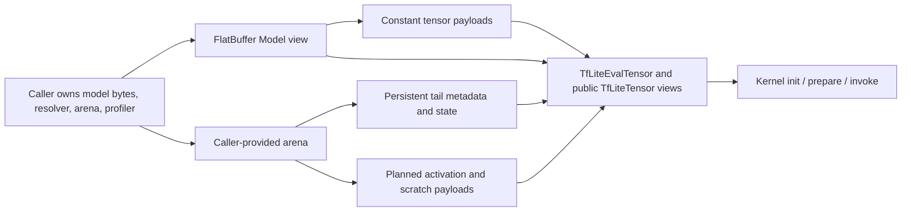
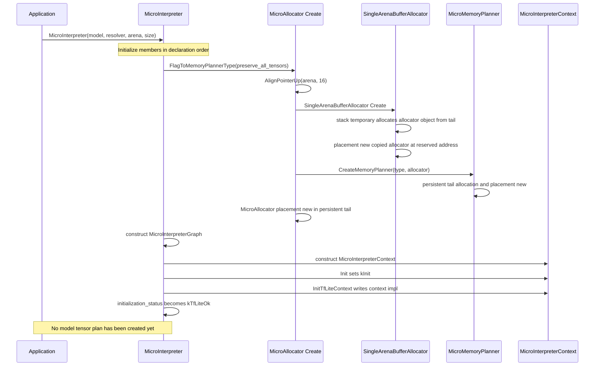
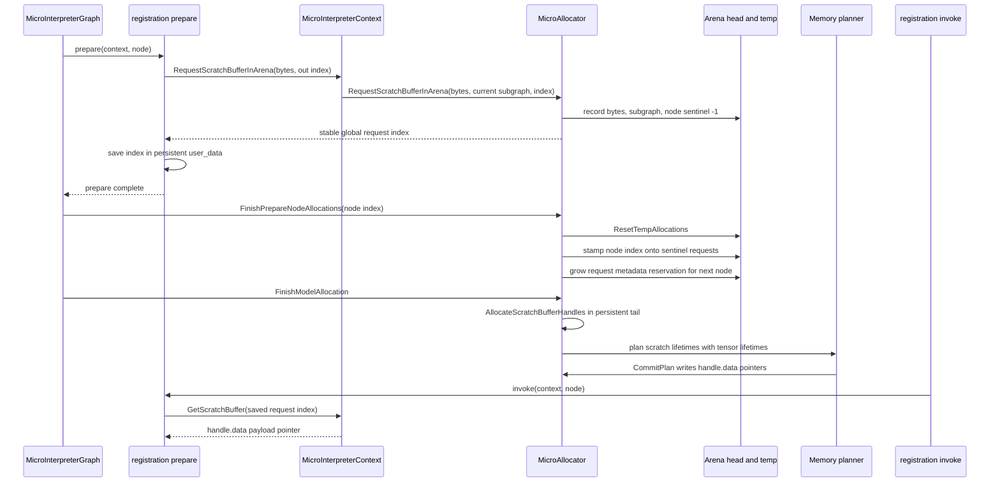
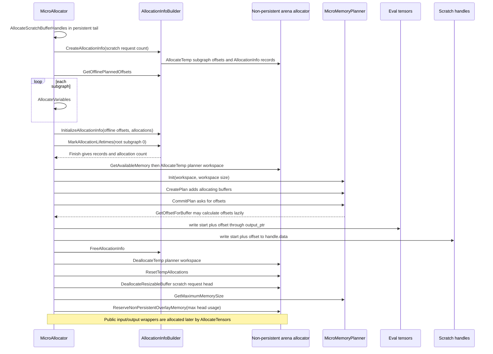

# MicroInterpreter and arena allocation: a source walkthrough

> **Source revision:** [`8f6596d99898deaac36ebd8ff8bf1b9754fd2cd1`](https://github.com/boschsensortec/tflite-micro/commit/8f6596d99898deaac36ebd8ff8bf1b9754fd2cd1). This immutable revision is the reference for every source link and implementation claim below. It is not a request to change the base branch. This is a documentation walkthrough; it does not change runtime behavior.

## Contents

- [Scope and reading order](#scope-and-reading-order)
- [Vocabulary and ownership](#vocabulary-and-ownership)
- [Example entry points](#example-entry-points)
- [Construction](#construction)
- [AllocationTensors: the complete orchestration](#allocatetensors-the-complete-orchestration)
- [Model allocation metadata](#model-allocation-metadata)
- [Binding each operator](#binding-each-operator)
- [Kernel init and prepare: Fully Connected](#kernel-init-and-prepare-fully-connected)
- [Context bridge and phase permissions](#context-bridge-and-phase-permissions)
- [Scratch request lifecycle](#scratch-request-lifecycle)
- [Static memory planning](#static-memory-planning)
- [How tensor lifetimes are computed](#how-tensor-lifetimes-are-computed)
- [Greedy and linear planners](#greedy-and-linear-planners)
- [Arena mechanics](#arena-mechanics)
- [Public input and output tensors](#public-input-and-output-tensors)
- [Invocation, reset, and destruction](#invocation-reset-and-destruction)
- [Micro Speech and sequential arena reuse](#micro-speech-and-sequential-arena-reuse)
- [Design patterns, accurately named](#design-patterns-accurately-named)
- [Blueprint for an independent small interpreter](#blueprint-for-an-independent-small-interpreter)
- [Validation checklist and debugging](#validation-checklist-and-debugging)
- [Source index](#source-index)

## Scope and reading order

Start with the ordinary float Hello World route, then follow construction and
`AllocateTensors()` before reading the lifetime/planner algorithms. The later
quantized notes distinguish data representation and setup-time arithmetic from
the float path. The final speech section explains why two interpreter objects
can use one arena sequentially; it does not imply that simultaneous interpreters
can share that memory.

This document separates three kinds of statements:

1. **Source behavior** is a description of the cited revision, including
   awkward status handling and guard assumptions where relevant.
2. **Illustration** is invented for teaching. Graph sizes, lifetimes, byte
   counts, offsets, and memory diagrams marked illustrative are not measurements
   of either example model.
3. **Independent implementation advice** is a recommended design, not a claim
   that the cited implementation has that hardening or behavior.

The two halves of setup have different jobs. `MicroInterpreter` owns the
high-level sequence and dispatches operator callbacks. `MicroAllocator` turns
serialized model descriptions and kernel allocation requests into persistent
metadata, runtime tensor views, and a static head-memory plan. Kernels do not
implement the global planner: they use context services in `init` and `prepare`,
then consume evaluation tensors and any scratch pointers in `invoke`.

## Vocabulary and ownership

### Storage model

The model is a FlatBuffer byte image supplied by the caller. `GetModel(bytes)`
returns a typed view over those existing bytes: it is not a deep copy, and the
view operation is not full verification of every model field. Model storage
must remain alive and unchanged while the interpreter uses it. Constant tensor
payloads usually stay in the model's buffer table; the runtime tensor's `data`
points into those bytes. Shape vectors and several option/index vectors are also
used as FlatBuffer views where the ABI/layout permits it. Activation payloads,
mutable variables, runtime metadata, operator state, public tensor wrappers,
and scratch handles have different arena allocation policies; do not conflate
the metadata object with the tensor's data payload.



| Name | Meaning and typical lifetime | Ownership / address source |
|---|---|---|
| `Model` | Typed view of the serialized model | Caller-owned FlatBuffer bytes |
| `TfLiteEvalTensor` | Lightweight per-model tensor metadata used while evaluating | Persistent tail record; its payload may point into model bytes, the planned head, or the tail for variables |
| `TfLiteTensor` | Richer temporary prepare-time wrapper, or persistent public input/output wrapper | Temporary arena during prepare; tail for interpreter `input()`/`output()` wrappers |
| Tensor payload | Bytes holding weights, activation, input/output values, or variable state | Model buffer for constants; planned head for ordinary runtime activations; tail for online variable state |
| `builtin_data` | Parsed builtin options for a `TfLiteNode` | Persistent tail allocation through `MicroBuiltinDataAllocator` |
| `user_data` | Operator-specific state returned by registration `init` | Defined by kernel; Fully Connected uses persistent allocation |
| Scratch request | Requested byte count plus owning node/subgraph | Temporary planning metadata stored in the head during setup |
| Scratch handle | Stable request-index-to-pointer record | Persistent tail record; `handle.data` points into the planned head |

Tensor **ordinals** are not tensor indexes. `input(0)` means the first entry in
the main subgraph's input-index vector; that vector's value selects an entry in
the subgraph-wide tensor table. Likewise for outputs. `model->operator_codes()`
is a table of operator *types* referenced through each operator's
`opcode_index`; `subgraph->operators()` is the ordered sequence of graph nodes.
`TfLiteTensor` is not `TfLiteEvalTensor`: the first supplies richer data for
prepare/public APIs, the second is the lean evaluation representation. A scratch
request index is not a data pointer: it becomes a handle index, whose `data`
member is finally assigned an actual planned pointer.

## Example entry points

The example test's `main()` runs memory profiling, float inference, then
quantized inference. `HelloWorldOpResolver` is `MicroMutableOpResolver<1>`:
capacity one means one *distinct registered operator type*, not one graph node.
The example has a single Fully Connected registration; do not infer an actual
operator count for an arbitrary model from resolver capacity.

The test uses an arena of 3000 bytes, explicitly described there as a round
number rather than a universal required size. Its ordinary float path is the
main trace below. In the recording alternative, `ProfileMemoryAndLatency()`
creates a `MicroProfiler`, a `RecordingMicroAllocator`, a
`MicroResourceVariables` object with capacity 24, and a
`RecordingMicroInterpreter`; then it allocates, runs one inference, logs
profiling tags, and prints recorded allocations. This is a profiling setup and
has its own accounting overhead; it is not the ordinary interpreter path.

For the int8 example, the test obtains the public input/output wrappers,
feeds signed int8 samples, and computes a real-valued result as
`(output_int8 - output_zero_point) * output_scale`. Input quantization has the
corresponding scale/zero-point mapping (with rounding/clamping defined by the
model's quantization contract); the hard-coded golden bytes in the test are
example data, not a general quantization algorithm. The model's int8 output
scale and zero point are read from its tensor wrapper. No actual operator count,
tensor offset, arena peak, or timing is asserted here.

The main float flow below is annotated in separate sections rather than hiding
all allocation details in one very large diagram:

1. [Construction](#construction): caller storage to self-hosted allocator and
   phase-aware context.
2. [Allocation front half](#allocatetensors-the-complete-orchestration):
   model views, operator binding, init, and prepare.
3. [Prepare and scratch](#scratch-request-lifecycle): temporary wrappers and
   scratch request identifiers.
4. [Planning](#static-memory-planning): lifetimes, offsets, pointer writeback,
   and overlay reservation.
5. [Finalization and invoke](#public-input-and-output-tensors):
   persistent public tensors, reset, and the first evaluation call.
6. [Speech reuse](#micro-speech-and-sequential-arena-reuse): two sequential
   interpreter lifetimes on one static buffer.

## Construction

`MicroInterpreter`'s members are initialized in declaration/initializer order
before the constructor body runs. In the ordinary constructor, the reference
member `allocator_` binds to the object returned by
`MicroAllocator::Create(...)`; the graph and context retain references/pointers
to the allocator/model/graph, then `Init()` sets context state, initializes the
TfLite context bridge, and records successful interpreter initialization.
Therefore `Init()` does **not** allocate model tensors. Allocation starts later
in `AllocateTensors()` or lazily on the first `Invoke()`.

`FlagToMemoryPlannerType(preserve_all_tensors)` chooses linear planning when
preserving all tensors and greedy planning otherwise. The arena constructor
path aligns the incoming address, makes a `SingleArenaBufferAllocator`, creates
the planner, and placement-constructs `MicroAllocator` in persistent arena
memory. `SingleArenaBufferAllocator::Create()` first uses a stack temporary to
reserve its own object from the arena tail, then placement-news a copy of the
temporary allocator at that address. The planner object and allocator object
are separate tail residents. A constructor supplied an existing `MicroAllocator`
bypasses this factory path; the allocator's existing planner and lifetime are
the caller's responsibility.



The C-facing callback bridge is deliberately small: the C++ `TfLiteContext`
stores `impl_`; `MicroContext::InitTfLiteContext()` writes `this` there.
`TfLiteContext`'s C++ callback members are `Method<&MicroContext...>` wrappers
that invoke static bridge functions; those functions call `GetMicroContext(ctx)`
and dispatch to the virtual `MicroContext` API. This uses C-compatible
function-pointer-shaped API entries with a C++ implementation behind them; it
does not mean a C function pointer has the context object captured as a closure.

`SingleArenaBufferAllocator::AllocatePersistentBuffer()` is not a complete
general-purpose checked allocator: it subtracts from the tail, aligns down,
then compares against `head_` (not `temp_`). Setup phase discipline and the
other allocator operations matter. The educational allocator later in this
document shows stronger bounds and overflow checks and is intentionally not a
line-for-line reproduction of these guards. Several factory placement-new paths
also rely on capacity being sufficient after `TFLITE_DCHECK`s; do not treat
those debug assertions as production capacity checks.

## AllocateTensors: the complete orchestration

The ordering in `MicroInterpreter::AllocateTensors()` is important. In
particular, `FinishModelAllocation()` plans runtime activations before the
interpreter allocates its persistent input and output pointer arrays and public
`TfLiteTensor` wrappers. It then resets graph/operator state and only after that
sets `tensors_allocated_` and enters invoke state.

```mermaid name=allocation-front-half
sequenceDiagram
  participant MI as MicroInterpreter
  participant A as MicroAllocator
  participant G as MicroInterpreterGraph
  participant C as MicroInterpreterContext
  participant R as Resolver
  participant K as Kernel registrations
  MI->>A: StartModelAllocation(model)
  A-->>MI: SubgraphAllocations or null
  alt allocation start failed
    MI->>MI: set initialization_status error; return error
  else allocation metadata exists
    MI->>G: SetSubgraphAllocations
    MI->>MI: PrepareNodeAndRegistrationDataFromFlatbuffer
    MI->>R: GetRegistrationFromOpCode for each ordered operator
    MI->>MI: parse builtin options and form TfLiteNode views
    MI->>C: SetInterpreterState(kInit)
    MI->>G: InitSubgraphs
    loop each subgraph and node in order
      G->>K: registration.init(context, options, length)
      K-->>G: node.user_data
    end
    MI->>C: SetInterpreterState(kPrepare)
    MI->>G: PrepareSubgraphs
    loop each subgraph and node in order
      G->>K: registration.prepare(context, node)
      K-->>G: status and scratch requests
      G->>A: FinishPrepareNodeAllocations(node index)
    end
    MI->>C: SetInterpreterState(kMemoryPlanning)
    MI->>A: FinishModelAllocation(model, allocations, handles out)
    A-->>MI: static plan and scratch handle array
    MI->>C: SetScratchBufferHandles(handles)
    MI->>A: AllocatePersistentBuffer(input pointer array)
    loop each main-subgraph input ordinal
      MI->>A: AllocatePersistentTfLiteTensor(global tensor index)
    end
    MI->>A: AllocatePersistentBuffer(output pointer array)
    loop each main-subgraph output ordinal
      MI->>A: AllocatePersistentTfLiteTensor(global tensor index)
    end
    MI->>G: ResetSubgraphs, then ResetVariableTensors
    MI->>MI: tensors_allocated = true; state = kInvoke
  end
```

Numbered function-by-function pass:

1. `MicroAllocator::StartModelAllocation(model)` checks
   `model_is_allocating_`, sets it, constructs persistent builtin-option
   allocator state, initializes scratch request metadata, and allocates each
   subgraph's allocation record, eval-tensor array, and node/registration array.
2. `graph_.SetSubgraphAllocations()` installs those arrays in the graph.
3. `PrepareNodeAndRegistrationDataFromFlatbuffer()` binds each ordered
   operator's registration and creates a `TfLiteNode` whose index arrays/options
   point to data or views derived from the FlatBuffer.
4. The interpreter sets `kInit`; `InitSubgraphs()` invokes each non-null
   registration `init` in subgraph/operator order.
5. The interpreter sets `kPrepare`; `PrepareSubgraphs()` invokes each
   non-null `prepare`, checks that output dimensions are not dynamically sized,
   and calls `FinishPrepareNodeAllocations(node_index)`.
6. The interpreter sets `kMemoryPlanning`; `FinishModelAllocation()` allocates
   scratch handles, constructs and commits one static plan, and completes
   model-allocation bookkeeping.
7. `SetScratchBufferHandles()` gives the context the persistent request-index
   map. `AllocateTensors()` then allocates persistent `TfLiteTensor*` arrays
   and one wrapper for every main-subgraph public input/output ordinal.
8. `Reset()` calls graph reset callbacks, then resets variable tensors and
   resource variables. On success the interpreter marks tensors allocated and
   enters `kInvoke`.

The initial failed `StartModelAllocation()` path explicitly changes
`initialization_status_` to error. Later errors are not uniformly reflected in
that field. Early returns may leave `model_is_allocating_` true, and init/prepare
errors may leave graph bookkeeping indexes or interpreter phase state unrestored.
This revision does not provide a transactional, idempotent allocation retry:
reconstructing arena-backed state is the safer recovery strategy, subject to
the lifetime rules for borrowed model, resolver, arena, resource-variable, and
profiler objects.

## Model allocation metadata

`StartModelAllocation()` does not lay out every activation payload. It creates
the persistent *records* needed to traverse and run the graph:

- A `MicroBuiltinDataAllocator`, whose `Allocate()` routes parsed builtin
  parameters to persistent arena storage and whose `Deallocate()` is a no-op.
- An initial head reservation for up to 12 `ScratchBufferRequest` records.
  This is request bookkeeping, not 12 scratch payloads.
- A `SubgraphAllocations` record per FlatBuffer subgraph.
- A persistent `TfLiteEvalTensor` record for each model tensor. Initialization
  maps constants to existing FlatBuffer payload bytes, and shape metadata can
  be represented as a view. Mutable activation pointers are generally null at
  this point.
- A persistent `NodeAndRegistration` array per subgraph, later populated with
  registrations and nodes.
- Optionally, a compressed-tensor lookup list when compression support is
  compiled in.

Online variables are special: `AllocateVariables()` gives them persistent
tail payloads later in `CommitStaticMemoryPlan()`. Non-variable, non-constant,
nonzero tensors with null data are candidates for the planned head. `AllocationInfo`
keeps metadata pointer-to-pointer targets so the final plan can write the
selected head addresses into eval tensors or scratch handles.

The FlatBuffer mapping is zero-copy only where data already exists. A missing
or zero-length serialized buffer does not supply a constant payload pointer.
`InitializeTfLiteEvalTensorFromFlatbuffer()` initializes evaluation metadata,
not the activation arena plan; `GetModel()` should not be described as a full
verification/deep-copy step.

## Binding each operator

`PrepareNodeAndRegistrationDataFromFlatbuffer()` iterates subgraphs and each
subgraph's operators in order. For an operator:

1. Read `op->opcode_index()` and reject it if it is outside
   `model->operator_codes()`.
2. Resolve the `OperatorCode` via `GetRegistrationFromOpCode(opcode,
   op_resolver, &registration)`. This connects an operator *type* with kernel
   callbacks; repeated graph nodes may reuse the same registration.
3. Determine whether the resolved type is custom. For a custom operator,
   custom-option bytes are passed through as existing FlatBuffer storage when
   present. For a builtin, custom options are rejected; fetch the
   `GetOpDataParser(op_type)` parser and call `CallBuiltinParseFunction()`.
   The bridge allocator stores parsed `builtin_data` persistently.
4. Convert the operator's input/output index vectors into `TfLiteIntArray`
   views. Intermediate indices are handled similarly when present. These are
   graph-wide tensor indexes (with optional `-1` entries), not input/output
   ordinals.
5. Clear the destination `TfLiteNode`, then set `inputs`, `outputs`,
   `builtin_data`, custom initial bytes/size, and optional intermediates.
   Kernel `init` has not run yet; option parsing/binding is not kernel
   initialization or preparation.

The parser is selected by builtin operator type; the node registration comes
from the op resolver. The custom/builtin branches matter because custom
initialization bytes are user-provided opaque data, while builtin data is
parsed into a runtime structure. This is registry plus function-pointer
dispatch, not dynamic code loading.

## Kernel init and prepare: Fully Connected

The ordinary Hello World resolver registers the Fully Connected operator type.
The portable implementation's registration binds `FullyConnectedInit`,
`FullyConnectedPrepare`, and `FullyConnectedEval`. A platform may substitute an
optimized registration/kernel (for example CMSIS-NN or a vendor implementation);
the portable reference path is the one described here, not a claim that every
build executes it.

### Init

`FullyConnectedInit()` asks the context for persistent storage of
`sizeof(OpDataFullyConnected)` and returns the pointer. `InitSubgraphs()` saves
that return as `node->user_data`. The persistent user data holds data computed
once for later evaluation; it is different from parsed `node->builtin_data`
which contains model options such as activation configuration.

### Prepare

`FullyConnectedPrepare()` gets the `MicroContext` from `TfLiteContext`, casts
the node's `user_data` and builtin options, then obtains temporary wrappers for
input, filter, optional bias, and output. It checks required tensor types. For
the supported floating case it checks float input/filter compatibility. For
quantized paths it accepts the supported int8/int4/int16 combinations encoded
in this implementation. Temporary wrappers are allocated from the temp
section; their payload points at the model constant or eval-tensor payload as
appropriate.

For int4 filter storage, this portable source requests scratch space to unpack
the filter into int8 at invoke time. Ordinary float Fully Connected and the
ordinary int8 filter path do **not** request this filter-unpacking scratch.
With compression compiled in, separate conditional decompression scratch
requests can also occur for compressed tensors. Do not infer a Hello World
scratch allocation from the existence of the API.

`CalculateOpDataFullyConnected()` returns immediately for float data. For
quantized data it inspects affine filter quantization, determines per-channel
mode, may allocate per-channel multipliers and shifts persistently, computes
quantized multipliers/shifts, records zero points, and calculates activation
bounds. Those stored parameters are consumed by quantized evaluation. The
quantized kernels use integer accumulators/requantization; their exact
rounding, shift, saturation, and activation-clamp behavior is defined by the
helper/reference kernel implementation and must not be approximated as a
simple floating multiply if numerical compatibility is required.

At the end, `FullyConnectedPrepare()` deallocates the temporary input/filter,
optional bias, and output wrappers. `PrepareSubgraphs()` then calls
`FinishPrepareNodeAllocations()` after each node. The graph code in this
revision does not propagate that helper's returned status; the independent
implementation blueprint recommends doing so.

During `FullyConnectedEval()`, the callback gets input/filter/bias/output
`TfLiteEvalTensor` views via `GetEvalInput`/`GetEvalOutput`; it does not build
the heavier temporary wrappers used in prepare. The float branch invokes the
portable reference Fully Connected calculation. Quantized branches select
appropriate integer reference routines, with an int4 branch using the saved
scratch handle to unpack filter values. Optimized platforms can replace these
portable routines while retaining the registration/context contract.

For intuition only, float Fully Connected computes
`y = activation(W x + b)` (bias may be absent). A quantized version represents
real values approximately as `scale * (q - zero_point)` and computes a
requantized integer result with per-tensor or per-channel parameters. This
equation is explanatory, not a substitute for reproducing TFLM's verified
fixed-point multiplier/rounding and saturation semantics.

## Context bridge and phase permissions

Kernels receive `TfLiteContext*`; they should not reach inside
`SingleArenaBufferAllocator`. TFLM's path is:

1. The `TfLiteContext` callback façade invokes a bridge function such as
   `MicroContextRequestScratchBufferInArena(ctx, bytes, &index)`.
2. `GetMicroContext(ctx)` casts `ctx->impl_` to the abstract `MicroContext*`.
3. In the interpreter, that object is `MicroInterpreterContext`, which checks
   phase permissions (mostly `TFLITE_DCHECK`) and delegates to `MicroAllocator`.
4. The interpreter context asks the graph for the current subgraph and node
   indices when associating requests or tensor lookups.

The abstract `MicroContext` API is the kernel-facing service interface; its
concrete interpreter implementation is an adapter from generic callbacks to
interpreter graph/allocator services. The API limits coupling and makes kernel
tests able to substitute a fake. Many phase restrictions are debug checks, not
release-mode runtime enforcement; an independent implementation should enforce
invalid-phase operations with statuses rather than rely only on assertions.

| Operation | Intended phase | Source-level behavior |
|---|---|---|
| Allocate persistent state | Init or prepare | Context uses a debug phase check, then allocator tail allocation |
| Request scratch | Prepare | Context checks phase, stores size and graph's current subgraph |
| Allocate temporary tensor/buffer | Prepare or kernel scoped service | Temporary arena API; caller must deallocate/reset as expected |
| Get scratch pointer | Invoke | Context checks invoke phase and indexes the handle array |
| Get eval tensor | Invoke-side graph access | Returns current subgraph's eval tensor record |

## Scratch request lifecycle

The scratch protocol separates request identity, persistent handle metadata,
and the payload:



`kMaxScratchBuffersPerOp` is 12. At request time the allocator counts
unassigned (`node_idx == -1`) requests for the current prepare block, enforces
that limit, stores the request in the reserved head list, returns its global
index, and increments the request count. The returned index is stable; it is
not the address of the future bytes. At `FinishPrepareNodeAllocations()`, temp
allocations are reset, unassigned requests are associated with that node index,
and head space for the accumulated list plus up to 12 more request records is
reserved for the next operator.

`FinishModelAllocation()` allocates a contiguous `ScratchBufferHandle[]` in
the persistent tail. It then plans each scratch payload's address at the
request's node/subgraph lifetime and points `AllocationInfo::output_ptr` at
`handle.data`. The scratch bytes live in the head and can overlap/reuse head
addresses when lifetimes do not overlap; the handle objects remain persistent.
The public callback `GetScratchBuffer(index)` returns the committed
`handle.data`.

## Static memory planning

`CommitStaticMemoryPlan()` combines all subgraphs and scratch requests into one
plan. The following diagram follows its actual order, including the planner
workspace and the head-reservation step:



The detailed order is:

1. `AllocateScratchBufferHandles()` reserves persistent tail entries for stable
   handles (if requests exist).
2. `AllocationInfoBuilder::CreateAllocationInfo()` reserves temp
   `subgraph_offsets` and one contiguous `AllocationInfo` record per tensor plus
   scratch request. Each record carries bytes, `void** output_ptr`, creation and
   last-use timestamps, offline offset, and `needs_allocating`.
3. `GetOfflinePlannedOffsets()` searches model metadata for the
   `OfflineMemoryAllocation` record and exposes its offset array after checking
   the tensor count. It assumes the metadata layout's contents are suitable;
   this lookup is not general verification of all offsets or their semantics.
4. `AllocateVariables()` allocates online variable tensor data persistently in
   the tail; variables with offline offsets are marked for planned storage.
5. `InitializeAllocationInfo()` validates subgraphs (including the restriction
   that nonzero-size operator intermediate tensors are unsupported), computes
   byte sizes, sets each `output_ptr` to the eval tensor's data pointer, and
   marks only eligible null-data non-variable nonzero tensors for planning.
   Scratch records are also initialized for planning.
6. `MarkAllocationLifetimes(root_subgraph=0)` fills each planned record's
   lifetime and connects scratch records to persistent handles.
7. `CommitStaticMemoryPlan()` computes remaining arena capacity, allocates that
   amount temporarily for planner workspace, initializes the planner, calls
   `CreatePlan()`, then `CommitPlan()`. `CreatePlan()` aligns requested bytes to
   `MicroArenaBufferAlignment()` and passes size, lifetime, and optional
   offline offset to `AddBuffer()`.
8. `CommitPlan()` calls `GetOffsetForBuffer()` and writes
   `overlay_start + offset` through each record's pointer-to-pointer target.
   `GreedyMemoryPlanner` computes offsets lazily when `GetOffsetForBuffer()` or
   `GetMaximumMemorySize()` calls `CalculateOffsetsIfNeeded()`.
9. The source frees builder records, calls `DeallocateTemp(planner_arena)`,
   resets temp bookkeeping, and deallocates the resizable scratch-request
   reservation. It then asks the planner for maximum planned size, updates
   `max_head_buffer_usage_`, and calls `ReserveNonPersistentOverlayMemory()`.
   The planner object itself is persistent in tail; its arrays/workspace are
   supplied from temp arena. The source accesses the planner's recorded results
   after temp bookkeeping reset but before replacing the head with the overlay;
   these arrays still occupy the bytes until overwritten. Pointer commitment by
   itself did not reserve the final head capacity: overlay reservation does.
10. Only after that does `AllocateTensors()` allocate the persistent input and
    output pointer arrays and full wrappers.

`max_head_buffer_usage_` preserves the largest head requirement seen through
that allocator's model-allocation use. `used_bytes()` combines current
non-persistent usage and tail usage; it is not automatically a measurement of
the maximum transient setup peak. Recording allocators, build flags, alignment,
pointer size, compiler ABI, quantization wrappers, resolver/kernel choice, and
platform optimizations can all change observed usage. Do not label a final used
byte count as the setup peak without measuring that peak separately.

## How tensor lifetimes are computed

`AllocationInfo` is a planning record, not the tensor itself. Its `output_ptr`
points to the pointer slot to fill. Records are laid out contiguously by
subgraph and then scratch request; a subgraph-offset table maps global record
storage to each local tensor index. `needs_allocating` is normally true for a
nonzero-byte tensor whose eval data pointer is null and which is not a variable.
Constants have non-null FlatBuffer pointers and are skipped. Online variables
are allocated in persistent tail before planning; offline-planned variables can
be planned at their given offset.

The lifetime walker uses a monotonically increasing `allocation_scope_count_`:

- Subgraph inputs are marked created at entry and also used at entry, so even
  unused input ports have a nonempty conservative lifetime.
- Each operator advances the scope. Its outputs receive their first-created
  time before uses are updated; nonnegative input indexes receive last-used
  time at that operator. Optional input `-1` (for example absent bias) is
  skipped. Outputs also receive a last-use time at their producing operator.
- A scratch buffer is created at its node's scope start and last used at that
  node's scope, giving a one-node lifetime.
- Subgraph outputs are extended through subgraph return. Empty subgraphs receive
  a valid output timestamp.
- `IF`, `WHILE`, and `CALL_ONCE` recurse into their referenced subgraphs with
  new allocation scopes. Tensor lifetimes only extend; scratch for a control
  flow node spans the nested subgraph scopes, preventing it from aliasing nested
  storage that can be live during that call.

The planner's time-conflict test is inclusive:
`a.first <= b.last && b.first <= a.last`. Thus a producer output and an input
consumed by the same operator conflict at that operator's timestamp; they
cannot be reused merely because the input is last used there. Address ranges
are half-open: `[offset, offset + aligned_size)`. Adjacent buffers can share an
endpoint without overlapping bytes. Offline offsets are fixed placements and
must be validated against every simultaneously-live buffer.

### Illustrative linear graph

The following is **invented** and uses illustrative byte sizes, lifetimes,
alignment, and offsets. It is not the Hello World model's tensor table or
measured arena layout. Assume 16-byte alignment and three ops:
`op0: input -> A`, `op1: A + input -> B`, `op2: B -> output`.

| Buffer | Illustrative raw bytes | Aligned bytes | Inclusive live scopes | Illustrative offset | Reason |
|---|---:|---:|---|---:|---|
| `input` | 20 | 32 | `0..2` | 0 | Main graph input retained through last use |
| `A` | 17 | 32 | `1..2` | 32 | Produced at op0; consumed at op1 |
| `B` | 24 | 32 | `2..3` | 64 | Produced at op1; consumed at op2 |
| `output` | 8 | 16 | `3..3` | 96 | Graph output remains live through return |

These illustrative live intervals all touch or overlap at a producing/consuming
scope, so this particular placement does not reuse a slot. If another
intermediate dies at scope 1 and a new tensor begins at scope 3, it may use the
same address only when the inclusive lifetimes do not intersect and the byte
ranges fit; a tensor consumed by op1 cannot alias that op1's output. The graph
inputs/outputs are included in this check even if not every buffer is an
activation candidate.

## Greedy and linear planners

`GreedyMemoryPlanner` is a heuristic interval allocator. Its function-level
flow:

1. `Init(workspace, bytes)` partitions caller-provided temp workspace into
   `BufferRequirements[]`, size/id sorting arrays, offset-sorted list entries,
   and output offsets. `max_buffer_count_` derives from workspace size and
   per-buffer storage requirements. The planner object itself is a distinct
   persistent tail allocation.
2. `AddBuffer(size, first, last)` checks capacity, stores a request, marks the
   plan dirty, and returns an error if full. The offline overload records a
   fixed offset after the ordinary add.
3. `CalculateOffsetsIfNeeded()` returns immediately for a clean or empty plan.
   It partitions fixed-offset buffers first, initializes their offsets, and
   sorts online buffer sizes descending with `ReverseSortInPlace`. That
   adjacent-swap sort is stable for equal values because it swaps only when
   the earlier size is smaller; do not claim a special id tie policy beyond
   this observed stability.
4. For each buffer, the planner walks buffers already sorted by address and
   considers only those whose time intervals overlap. `DoesEntryOverlapInTime()`
   uses inclusive endpoints. `NextSimultaneouslyActiveBuffer()` finds the next
   time-conflicting placement. The planner scans address gaps from offset zero,
   advancing the candidate end past each active predecessor, and chooses the
   first gap large enough; if no gap fits it appends after the last active
   buffer. It inserts the new entry into address order.
5. `GetOffsetForBuffer()` calls `CalculateOffsetsIfNeeded()` lazily, validates
   the index, and returns its planned byte offset.
   `GetMaximumMemorySize()` also calculates lazily and returns the largest
   `offset + size`. `DoAnyBuffersOverlap()` checks each pair and reports
   collisions only when both their inclusive time intervals and half-open
   address intervals overlap.

This first-fit / descending-size heuristic is not guaranteed to find a globally
optimal packing. Its fixed offsets are considered before online allocations,
which allows online buffers to occupy their gaps; conflicting offline plans
must be detected/avoided by validation rather than trusted blindly.

`LinearMemoryPlanner` instead assigns each added buffer the next free offset and
never reuses storage. It is simple and supports the preserve-all-tensors
behavior (`GetTensor()` is only allowed when the planner preserves every
tensor), but generally uses more head memory. The independent implementation
blueprint starts with linear planning before adding reuse.

Offline planning is optional metadata named `OfflineMemoryAllocation`; source
format documentation describes an offset vector and `-1` for runtime planning.
At this revision the builder finds the named metadata, reads its embedded
offset array, and checks the reported tensor count. It does not establish that
all offsets are aligned, in bounds, or collision-free. Treat the FlatBuffer and
offline plan as inputs that must be validated in a robust independent system.
This planner operates on known-size tensors; do not read this as general support
for dynamic shapes. Prepare rejects dynamic output dimensions in this graph
path.

## Arena mechanics

`SingleArenaBufferAllocator` manages one contiguous byte buffer with `head_`
growing toward higher addresses and `tail_` growing toward lower addresses.
`temp_` advances above the persistent head during temporary setup and resets to
`head_` when all tracked temp allocations are released. The resizable head is
used first for scratch-request metadata, then repurposed for planned overlay
payloads. Thus the same low-address bytes have different setup and invoke-time
roles.

```text name=arena-memory-layout
Before setup (illustrative; addresses increase left-to-right)
low address                                                            high address
| head/overlay (empty) | free space                                 | persistent tail |
^ buffer_head          ^ temp=head                                   ^ tail

During prepare/planning
| scratch request records / planned workspace in temp | free | persistent tail |
^ head                 ^ temp grows upward                         ^ tail grows downward
                        head <= temp < tail

After plan reservation (invoke-time overlay)
| planned activation and scratch overlay | free setup gap             | persistent tail |
^ buffer_head                            ^ head=temp                  ^ tail
```

`AlignPointerUp` and `AlignPointerDown` adjust addresses to required boundaries;
alignment padding consumes usable space. The model's arena alignment is 16
bytes. Persistent allocations bump the tail down. Temporary allocations bump
`temp_` up, track a count/checksum, and require explicit `DeallocateTemp()`
bookkeeping before `ResetTempAllocations()` succeeds. `DeallocateTemp()` only
updates tracking; it does not rewind `temp_`. Reset verifies no tracked temps
remain and sets `temp_ = head_`.

`ResizeBuffer()` supports one resizable buffer at the start of the head and
requires `head_ == temp_`; the caller must reset temps before resizing. It
checks the request against tail availability, then updates head and temp.
`ReserveNonPersistentOverlayMemory()` uses this mechanism to set the final
head length. `GetNonPersistentUsedBytes()` returns the larger of head and temp
displacement from the buffer head; `GetUsedBytes()` sums that with persistent
tail usage.

An educational, safer bump allocator should check integer arithmetic and
capacity before forming out-of-range pointers. It is a design sketch, not the
source's exact guard behavior:

```cpp name=educational_allocator.cc
bool checked_add(size_t a, size_t b, size_t* out) {
  if (b > SIZE_MAX - a) return false;
  *out = a + b;
  return true;
}

bool allocate_up(uintptr_t begin, uintptr_t end, size_t bytes,
                 size_t alignment, uintptr_t* next, void** result) {
  if (alignment == 0 || (alignment & (alignment - 1)) != 0) return false;
  if (begin > UINTPTR_MAX - (alignment - 1)) return false;
  uintptr_t aligned = (begin + alignment - 1) & ~(alignment - 1);
  if (aligned > end || bytes > end - aligned) return false;
  *result = reinterpret_cast<void*>(aligned);
  *next = aligned + bytes;
  return true;
}

bool allocate_down(uintptr_t begin, uintptr_t current_tail, size_t bytes,
                   size_t alignment, uintptr_t* next_tail, void** result) {
  if (alignment == 0 || (alignment & (alignment - 1)) != 0) return false;
  if (current_tail < begin || bytes > current_tail - begin) return false;
  uintptr_t candidate = current_tail - bytes;
  uintptr_t aligned = candidate & ~(alignment - 1);
  if (aligned < begin) return false;
  *result = reinterpret_cast<void*>(aligned);
  *next_tail = aligned;
  return true;
}
```

For a production allocator, validate null pointers, alignment validity, buffer
ordering, checked conversions, alignment padding, tail/head/temp non-overlap,
zero-size policy, and object-construction capacity. Avoid computing a pointer
by unchecked `base + size` before checking overflow. Propagate every failure;
do not copy factory assumptions or treat `DCHECK` as capacity validation.

### Dual-arena alternative

The persistent/non-persistent allocator alternative uses distinct storage for
tail and head/temp responsibilities. `MicroAllocator::Create(persistent_arena,
persistent_size, non_persistent_arena, non_persistent_size, planner_type)`
constructs a `PersistentArenaBufferAllocator` and
`NonPersistentArenaBufferAllocator`; the latter retains a pointer to the
persistent allocator for its own persistent bookkeeping. This changes where
regions come from, not the model phases or tensor lifetime model. It is not
evidence that a single interpreter can be concurrently re-entered.

## Public input and output tensors

After the plan is reserved, `AllocateTensors()` first creates the persistent
input pointer array, then calls
`AllocatePersistentTfLiteTensor(model, allocations, tensor_index, 0)` for each
input ordinal. It repeats this for outputs. Each wrapper is allocated in tail,
populated from FlatBuffer tensor metadata, and then has `data.data` and `dims`
overridden from the matching `TfLiteEvalTensor`, which is the source of truth
for the planned payload and evaluation dimensions.

`InitializeTfLiteTensorFromFlatbuffer()` fills type, variable flag, buffer
pointer, byte count, and dimensions; scalar/null-shape cases use the zero-length
array. For quantization, it populates `params.scale` and converts the first
64-bit FlatBuffer zero point into the 32-bit `TfLiteQuantizationParams` field.
When affine arrays are present, it allocates an affine-quantization wrapper and
zero-point `TfLiteIntArray` in persistent or temp memory depending on caller.
The scale array is reused as a FlatBuffer view; zero points are copied into
32-bit storage, repeating the sole stored zero point if the scale array has
multiple channels. It does not duplicate the activation payload. Temporary
quantization wrappers are tracked/deallocated with their temporary tensor.

`input(index)` and `output(index)` in this revision only bounds-check and return
the previously allocated wrapper. They are not implicit allocators. Call
`AllocateTensors()` and check its returned status before using either API.
Passing an input/output ordinal to an API that expects a global tensor index is
a distinct indexing error.

## Invocation, reset, and destruction

```mermaid name=finalization-and-invocation
sequenceDiagram
  participant App as Application
  participant MI as MicroInterpreter
  participant Graph as MicroInterpreterGraph
  participant Context as MicroInterpreterContext
  participant Kernel as Registration and kernel
  participant Allocator as MicroAllocator
  App->>MI: AllocateTensors
  MI->>Allocator: finish plan and allocate public I/O wrappers
  MI->>Graph: ResetSubgraphs
  Graph->>Kernel: optional registration.reset callbacks
  MI->>Graph: ResetVariableTensors
  Graph->>Graph: zero variable payloads and reset resource variables
  MI->>MI: tensors_allocated true; context state kInvoke
  App->>MI: Invoke
  alt initialization status is not OK
    MI-->>App: error
  else tensors not allocated
    MI->>MI: AllocateTensors lazily
  end
  MI->>Graph: InvokeSubgraph(0)
  loop each operator in order
    Graph->>Kernel: optional ScopedMicroProfiler(op name)
    Graph->>Kernel: registration.invoke(context, node)
    Kernel->>Context: GetEvalInput and GetEvalOutput
    Context-->>Kernel: lightweight eval tensor pointers
    opt kernel has prepared scratch request
      Kernel->>Context: GetScratchBuffer(saved index)
      Context-->>Kernel: planned head payload address
    end
    Kernel->>Kernel: calculate output
    Graph->>Allocator: ResetTempAllocations
  end
  Graph-->>MI: invocation status; restore indexes on loop exit
  MI-->>App: status; output wrapper reads planned result
```

On a successful ordinary invoke, `MicroInterpreter::Invoke()` checks
`initialization_status_`, allocates tensors only if not already allocated, and
calls `InvokeSubgraph(0)`. The graph visits operators in order, optionally
constructs a `ScopedMicroProfiler` around each operator, then calls
`registration->invoke(context, node)`. Fully Connected reads `TfLiteEvalTensor`
inputs/outputs, executes the selected float/integer path, and returns status.
After each node, the graph resets temporary allocations before proceeding.
Successful repeated `Invoke()` calls do not re-run static planning.

Source caveats:

- `InvokeSubgraph()` ignores the return value of `ResetTempAllocations()` in this
  revision. It does propagate kernel invoke status and restores graph indexes
  after leaving the node loop, including on a kernel error; invalid-subgraph
  early return occurs before restoration.
- `PrepareSubgraphs()` calls `FinishPrepareNodeAllocations()` but ignores its
  status. Its init/prepare error paths can return before restoring saved
  subgraph/operator indexes.
- `AllocateTensors()` does not uniformly record subsequent failure in
  `initialization_status_`; some failures can leave `model_is_allocating_`
  set. Repeated allocation is not a supported transactional retry.
- When `AllocateTensors()` fails after partially constructing wrappers or
  metadata, do not assume that calling it again is safe. Reconstruct
  arena-backed interpreter/allocator state when practical.

`Reset()` invokes every non-null kernel registration `reset` callback across
subgraphs, then resets variable tensors, then resets `MicroResourceVariables`
if supplied. The graph's variable reset computes tensor byte length and fills
the payload with zero bytes; for int8 it uses the first quantization zero point
as the fill byte. Reset is not a blanket clear of the whole arena, all
activations, or every persistent object.

The interpreter destructor calls `graph_.FreeSubgraphs()` if allocations were
created; that function invokes each non-null registration `free` callback.
It does not individually free arena allocations or reset/release caller-owned
model, resolver, arena, resource variables, or profiler. The arena remains
caller-owned and is typically reclaimed as a whole by leaving its enclosing
scope.

## Micro Speech and sequential arena reuse

The Micro Speech test declares one shared
`alignas(16) uint8_t g_arena[28600]`; the nearby comment calls this a
platform-specific estimate (`xtensa p6`), not a universal requirement. It also
keeps `g_features` outside the arena.

```mermaid name=speech-arena-reuse
sequenceDiagram
  participant Test as TestAudioSample
  participant Features as GenerateFeatures
  participant Pre as Audio preprocessor interpreter
  participant Arena as shared g_arena
  participant Outside as g_features outside arena
  participant Speech as Micro Speech interpreter
  Test->>Features: GenerateFeatures(audio, g_features)
  Features->>Pre: construct interpreter using g_arena
  Pre->>Arena: AllocateTensors once
  loop each complete audio window
    Features->>Pre: GenerateSingleFeature(window)
    Pre->>Pre: copy int16 samples into input
    Pre->>Pre: Invoke
    Pre->>Outside: copy int8 feature output
  end
  Note over Pre,Arena: function returns; preprocessor interpreter lifetime ends
  Test->>Speech: LoadMicroSpeechModelAndPerformInference(g_features)
  Speech->>Arena: construct a different interpreter in same bytes
  Speech->>Arena: AllocateTensors for quantized classifier
  Speech->>Speech: copy int8 features into model input
  Speech->>Speech: Invoke
  Speech->>Speech: dequantize scores and argmax
  Speech-->>Test: compare expected label
```

`GenerateFeatures()` constructs the audio-preprocessor interpreter with
`g_arena`, allocates once, then loops over complete audio windows.
`GenerateSingleFeature()` copies int16 audio samples into the model input,
invokes, and copies int8 feature output into `g_features`, which is not in the
arena. When `GenerateFeatures()` returns, its local interpreter is destroyed.
`LoadMicroSpeechModelAndPerformInference()` then constructs a separate
quantized speech interpreter using the same `g_arena`, allocates the classifier
state, copies `g_features` into its input, invokes, dequantizes output scores,
and takes argmax.

This is safe sequential reuse because the first interpreter's lifetime ended
before the second allocation overwrites the arena, and the feature data survived
outside it. Overlapping interpreter lifetimes or concurrent use of the same
arena would invalidate that reasoning. A shared *existing* `MicroAllocator`
used by multiple interpreters has a different behavior: persistent tail
allocations accumulate and `max_head_buffer_usage_` tracks the largest
non-persistent head demand. That is not a fully reentrant or concurrent
execution engine.

The walkthrough stops at the model boundary: DSP/audio feature mathematics are
not needed to understand allocator lifetime or interpreter orchestration.

## Design patterns, accurately named

| Pattern / idiom | Concrete symbols | Why it is used | Boundary / limitation |
|---|---|---|---|
| Facade | `MicroInterpreter` | Presents construction, allocation, invocation, reset, and I/O access as one API | Delegates planning and graph execution; not the owner of caller storage |
| Strategy | `MicroMemoryPlanner`, `GreedyMemoryPlanner`, `LinearMemoryPlanner` | Switches between reuse-oriented and preserve-all planning | Planner workspace is supplied separately; greedy is heuristic |
| Named/static factory plus placement construction | `MicroAllocator::Create`, `SingleArenaBufferAllocator::Create`, `CreateMemoryPlanner` | Reserves objects inside caller-provided storage without general heap ownership | Not necessarily the GoF Factory Method pattern; source has capacity assumptions |
| Dependency injection | resolver, allocator, resource variables, profiler constructor parameters | Injects operator set, storage policy, state service, and profiling | Lifetimes remain caller responsibility |
| Registry and function-pointer dispatch | `MicroMutableOpResolver`, `GetRegistrationFromOpCode`, `TFLMRegistration` | Maps operator type to callbacks and invokes registered `init/prepare/invoke` | No runtime plugin loading is implied |
| Adapter / context bridge | `TfLiteContext`, `impl_`, `MicroContext`, `MicroInterpreterContext` | Gives kernels a narrow service interface while graph/allocator remain internal | Phase enforcement is often debug-only |
| Builder | `AllocationInfoBuilder` | Separates record construction, validation, lifetime traversal, and completion | Temporary builder arrays are planning workspace metadata |
| Region/lifetime allocator | head/temp/tail `SingleArenaBufferAllocator` | Uses bulk lifetime regions instead of one general-purpose free per object | `DeallocateTemp` is bookkeeping; it does not rewind |
| Object self-hosting | allocator/planner objects placed into arena | Makes runtime allocation machinery live in the caller's arena | Not a conventional per-object heap pool |
| Two-phase kernel setup | registration `init` then `prepare`, followed by planning | Separates persistent kernel state from shape validation and scratch requests | Exact callbacks/status behavior should be made robust in a new engine |
| Explicit phase state machine | `kInit`, `kPrepare`, `kMemoryPlanning`, `kInvoke` | Gates context APIs by setup/execution phase | A phase enum is not automatically the GoF State pattern |
| RAII/scoped callback | `ScopedMicroProfiler`, registration reset/free callbacks | Balances profiler scopes and offers kernel lifecycle hooks | Arena storage is not automatically freed by RAII |
| Zero-copy views | FlatBuffer vector views and `TfLiteEvalTensor` | Avoids copies for immutable model metadata/payloads | Not every object is a view; pointer aliasing requires source lifetime |

Avoid overclaiming Singleton, Observer, Visitor, or Flyweight: they are not
useful descriptions of the specific mechanisms above.

## Blueprint for an independent small interpreter

The following is a feasible staged design for a **small fixed-shape linear
graph**, not a partial claim of TFLM compatibility. Start with a verified
model subset, a single contiguous caller arena, float Fully Connected, and a
linear planner. Add quantization, nested control flow, compression, offline
plans, multiple subgraphs, and optimized kernels only after each contract is
specified and tested.

### Minimal structures and interfaces

```cpp name=small-interpreter-types.h
struct TensorView {
  Type type;
  ShapeView shape;
  const void* constant_data;   // aliases model bytes, or null
  void* runtime_data;          // assigned during planning
  size_t bytes;
  bool is_variable;
};

struct Node {
  Registration* registration;
  int* input_tensor_indices;
  int input_count;
  int* output_tensor_indices;
  int output_count;
  const void* builtin_options;  // parsed or an immutable option view
  void* user_data;              // persistent kernel state
};

struct ScratchHandle { uint8_t* data; };

struct Planner {
  bool add_buffer(size_t aligned_bytes, int first, int last);
  bool get_offset(int id, size_t* offset);
  size_t maximum_bytes();
};

struct KernelContext {
  bool allocate_persistent(size_t bytes, size_t alignment, void** out);
  bool request_scratch(size_t bytes, int* stable_index);
  void* get_scratch(int stable_index);
  TensorView* tensor(int global_index);
};
```

These types are intentionally smaller than FlatBuffer/TFLM types. Keep explicit
ownership: the caller owns model bytes and arena; the interpreter borrows them;
the allocator owns no external buffer; all arena objects become invalid together
when the arena's enclosing lifetime ends.

### Setup and run pseudocode

```cpp name=small-interpreter-pseudocode.cc
Status Interpreter::allocate_model() {
  if (state_ != State::kUnallocated) return Status::kBadState;

  // Validate model lengths and indexes before following any FlatBuffer offsets.
  if (!parse_model_view(model_bytes_, &model_)) return Status::kBadModel;
  if (!arena_.initialize_checked(arena_bytes_)) return Status::kNoMemory;

  // Persistent records and option storage.
  tensors_ = arena_.tail_array<TensorView>(model_.tensor_count());
  nodes_ = arena_.tail_array<Node>(model_.operator_count());
  if (!tensors_ || !nodes_) return Status::kNoMemory;
  initialize_tensor_views(model_, tensors_);

  // Bind operator type -> registered callbacks; parse options into owned state.
  for (int n = 0; n < model_.operator_count(); ++n) {
    if (!bind_and_validate_node(model_, n, registry_, &nodes_[n]))
      return Status::kUnsupportedOperator;
  }

  state_ = State::kInit;
  for (Node& node : nodes_) {
    if (node.registration->init)
      node.user_data = node.registration->init(context_, node.builtin_options);
    if (node.registration->init && !node.user_data)
      return Status::kNoMemory;
  }

  // Prepare may inspect richer tensor information and register scratch by ID.
  state_ = State::kPrepare;
  for (int n = 0; n < model_.operator_count(); ++n) {
    if (nodes_[n].registration->prepare &&
        !nodes_[n].registration->prepare(context_, &nodes_[n]))
      return Status::kPrepareFailed;
    if (!scratch_.finish_node(n)) return Status::kNoMemory;
    temp_.reset_checked();
  }

  // Compute inclusive lifetimes; source inputs start at entry, graph outputs
  // remain live through return, and same-node uses/defs conflict.
  AllocationInfo* info = build_linear_graph_lifetimes(model_, tensors_, scratch_);
  if (!info) return Status::kNoMemory;
  for (const AllocationInfo& item : info) {
    if (item.needs_allocation &&
        !planner_.add_buffer(align_up_checked(item.bytes), item.first, item.last))
      return Status::kNoMemory;
  }
  if (!planner_.commit_pointers(info, arena_.overlay_start()))
    return Status::kBadPlan;
  if (!arena_.reserve_head(planner_.maximum_bytes()))
    return Status::kNoMemory;
  if (!create_scratch_handles_and_commit(scratch_, planner_, arena_))
    return Status::kBadPlan;
  if (!create_public_io_views(model_, tensors_, arena_))
    return Status::kNoMemory;

  state_ = State::kInvoke;
  return reset_model_state();
}

Status Interpreter::invoke() {
  if (state_ != State::kInvoke) return Status::kBadState;
  for (Node& node : nodes_) {
    Status status = node.registration->invoke(context_, &node);
    if (!temp_.reset_checked()) return Status::kInternalError;
    if (status != Status::kOk) return status;
  }
  return Status::kOk;
}
```

The pseudo-code intentionally insists on checked parsing, checked arena
operations, lifecycle state checks, and status propagation. For the first
milestone, use a fixed set of registrations, linear graph traversal, no
dynamic-shape tensors, and a no-reuse linear memory plan. Add a greedy planner
only after lifetime testing establishes that same-op inclusive endpoints are
handled correctly. Add quantized kernels only after tests verify
multiplier/shift generation, rounding, saturation, per-channel parameters,
optional bias, and activation clamping against a trusted implementation.

The source implementation's details that a compatible clone may additionally
need include FlatBuffer schemas, all supported builtins and custom operations,
resolver API parity, subgraphs/control flow, online/offline variables,
per-channel and integer types, resource variables, compression, profiler hooks,
the exact arena ABI/alignment, and build-specific kernel substitutions. This
blueprint is enough to build a small interpreter, not to claim that subset is
drop-in TFLM.

## Validation checklist and debugging

### Tests for an independent allocator/interpreter

- Test aligned and deliberately misaligned arena starts; verify expected lost
  padding and 16-byte arena alignment.
- Test exact-fit allocations, one-byte-too-small head/tail/temp requests,
  metadata placement failure, and head/temp/tail collision.
- Exercise integer overflow in `base + size`, alignment rounding, tensor byte
  counts, and `offset + aligned_size`.
- Verify constants still point into immutable model storage and activation
  payloads resolve through eval tensors into the planned overlay.
- Cover zero-sized tensors, scalar shapes, optional `-1` inputs, absent bias,
  and invalid input/output ordinals versus global tensor indexes.
- Enforce 12 scratch requests per node, stable indexes across later requests,
  correct request-to-handle mapping, and no scratch access before invoke state.
- Verify no arena allocation or planner invocation during steady-state repeated
  invokes; test that temporaries are reset after success and failure.
- Test inclusive lifetime endpoints: a tensor read and a tensor written by the
  same node must not alias. Also test safe reuse when one lifetime ends strictly
  before the next begins and half-open address ranges only touch.
- Validate offline offsets for alignment, bounds, and pairwise conflict before
  accepting them; include a deliberately conflicting fixed plan.
- Exercise repeated Invoke, Reset, variable zero fill including int8 zero point,
  resource-variable reset, partial initialization failure, and status
  propagation.
- Verify temp allocation/deallocation count/checksum and reset behavior;
  test dual arenas independently from single-arena behavior.
- Test recording/profiler builds separately because instrumentation can change
  memory and execution characteristics.

### Breakpoints in chronological order

1. `MicroInterpreter` constructor and `Init()` — confirm borrowed object
   lifetimes, initial state, and that no model tensors are yet planned.
2. `MicroAllocator::Create()` / `SingleArenaBufferAllocator::Create()` — inspect
   initial alignment and self-hosted persistent object positions.
3. `StartModelAllocation()` — inspect graph arrays, constant pointers, and
   scratch-request reservation.
4. `PrepareNodeAndRegistrationDataFromFlatbuffer()` — inspect operator code
   index, resolved registration, options, and index views.
5. `InitSubgraphs()` then `PrepareSubgraphs()` — watch `user_data`, temporary
   wrappers, phase, and request IDs.
6. `RequestScratchBufferInArena()` and `FinishPrepareNodeAllocations()` — watch
   sentinel-to-node assignment and reservation growth.
7. `CommitStaticMemoryPlan()` / `MarkAllocationLifetimes()` — inspect record
   lifetimes, offline offsets, and variable allocation.
8. `GreedyMemoryPlanner::CalculateOffsetsIfNeeded()` — inspect conflicting
   buffers, gaps, and actual offsets.
9. `CommitPlan()` then `ReserveNonPersistentOverlayMemory()` — confirm pointer
   writeback precedes final head reservation.
10. `AllocatePersistentTfLiteTensor()` — compare public tensor data/dims with
    the eval tensor source of truth.
11. `InvokeSubgraph()` / kernel `invoke` — confirm the saved scratch index
    resolves to the planned pointer and temp reset follows each operator.
12. `ResetVariableTensors()` and `FreeSubgraphs()` — distinguish data reset,
    kernel lifecycle callbacks, and bulk arena lifetime.

No model execution, memory measurement, timing run, or firmware build was
performed to prepare this source walkthrough. The examples' fixed arena sizes
and any `arena_used_bytes()` logging are source facts about the examples, not
measurements made for this document. Real memory requirements vary with target
pointer width, compiler/layout, alignment, model contents, optional features,
recording/profiling instrumentation, and selected optimized kernel.

## Source index

All links below are immutable links to the source revision stated at the top.
Line ranges are intended as entry points for review, not as replacements for
reading adjacent declarations and helper implementations.

### Examples and interpreter

- [Hello World float, recording, and quantized flows](https://github.com/boschsensortec/tflite-micro/blob/8f6596d99898deaac36ebd8ff8bf1b9754fd2cd1/tensorflow/lite/micro/examples/hello_world/hello_world_test.cc#L28-L158)
- [Micro Speech arena, inference, and feature generation](https://github.com/boschsensortec/tflite-micro/blob/8f6596d99898deaac36ebd8ff8bf1b9754fd2cd1/tensorflow/lite/micro/examples/micro_speech/micro_speech_test.cc#L35-L240)
- [MicroInterpreter construction, parsing, allocation, invoke, reset, and accessors](https://github.com/boschsensortec/tflite-micro/blob/8f6596d99898deaac36ebd8ff8bf1b9754fd2cd1/tensorflow/lite/micro/micro_interpreter.cc#L35-L318)
- [MicroInterpreter API, borrowed lifetimes, phase members](https://github.com/boschsensortec/tflite-micro/blob/8f6596d99898deaac36ebd8ff8bf1b9754fd2cd1/tensorflow/lite/micro/micro_interpreter.h#L45-L217)
- [Graph init, prepare, invoke, reset, and free callbacks](https://github.com/boschsensortec/tflite-micro/blob/8f6596d99898deaac36ebd8ff8bf1b9754fd2cd1/tensorflow/lite/micro/micro_interpreter_graph.cc#L80-L365)

### Allocator and context

- [Allocator factories, planner creation, persistent builtin data allocator](https://github.com/boschsensortec/tflite-micro/blob/8f6596d99898deaac36ebd8ff8bf1b9754fd2cd1/tensorflow/lite/micro/micro_allocator.cc#L61-L186)
- [Allocator factory and `StartModelAllocation` / `FinishModelAllocation`](https://github.com/boschsensortec/tflite-micro/blob/8f6596d99898deaac36ebd8ff8bf1b9754fd2cd1/tensorflow/lite/micro/micro_allocator.cc#L512-L687)
- [Scratch request / prepare finish / public persistent tensor allocation](https://github.com/boschsensortec/tflite-micro/blob/8f6596d99898deaac36ebd8ff8bf1b9754fd2cd1/tensorflow/lite/micro/micro_allocator.cc#L694-L835)
- [Temp tensor wrappers and allocation cleanup](https://github.com/boschsensortec/tflite-micro/blob/8f6596d99898deaac36ebd8ff8bf1b9754fd2cd1/tensorflow/lite/micro/micro_allocator.cc#L837-L915)
- [Eval tensors, variables, and persistent tensor population](https://github.com/boschsensortec/tflite-micro/blob/8f6596d99898deaac36ebd8ff8bf1b9754fd2cd1/tensorflow/lite/micro/micro_allocator.cc#L1036-L1114)
- [Plan commit, temp workspace, head reservation, scratch handles](https://github.com/boschsensortec/tflite-micro/blob/8f6596d99898deaac36ebd8ff8bf1b9754fd2cd1/tensorflow/lite/micro/micro_allocator.cc#L1116-L1254)
- [Tensor and quantization FlatBuffer population](https://github.com/boschsensortec/tflite-micro/blob/8f6596d99898deaac36ebd8ff8bf1b9754fd2cd1/tensorflow/lite/micro/micro_allocator.cc#L192-L340)
- [Allocator records, handles, planner types, and API contracts](https://github.com/boschsensortec/tflite-micro/blob/8f6596d99898deaac36ebd8ff8bf1b9754fd2cd1/tensorflow/lite/micro/micro_allocator.h#L52-L361)
- [Context bridge and phase-specific service implementation](https://github.com/boschsensortec/tflite-micro/blob/8f6596d99898deaac36ebd8ff8bf1b9754fd2cd1/tensorflow/lite/micro/micro_interpreter_context.cc#L47-L131)
- [Kernel-facing `MicroContext` interface and `impl_` setup declaration](https://github.com/boschsensortec/tflite-micro/blob/8f6596d99898deaac36ebd8ff8bf1b9754fd2cd1/tensorflow/lite/micro/micro_context.h#L37-L190)
- [TfLite context callback bridge and method wrappers](https://github.com/boschsensortec/tflite-micro/blob/8f6596d99898deaac36ebd8ff8bf1b9754fd2cd1/tensorflow/lite/micro/micro_common.h#L324-L386)
- [Bridge callbacks and `InitTfLiteContext`](https://github.com/boschsensortec/tflite-micro/blob/8f6596d99898deaac36ebd8ff8bf1b9754fd2cd1/tensorflow/lite/micro/micro_common.cc#L175-L200)

### Lifetimes, planners, arena, and kernels

- [Allocation record and builder declarations](https://github.com/boschsensortec/tflite-micro/blob/8f6596d99898deaac36ebd8ff8bf1b9754fd2cd1/tensorflow/lite/micro/micro_allocation_info.h#L26-L135)
- [Allocation record initialization, lifetime traversal, control flow, offline offsets](https://github.com/boschsensortec/tflite-micro/blob/8f6596d99898deaac36ebd8ff8bf1b9754fd2cd1/tensorflow/lite/micro/micro_allocation_info.cc#L35-L374)
- [Greedy planner initialization, sorting, placement, and conflict checks](https://github.com/boschsensortec/tflite-micro/blob/8f6596d99898deaac36ebd8ff8bf1b9754fd2cd1/tensorflow/lite/micro/memory_planner/greedy_memory_planner.cc#L40-L332)
- [Greedy planner offset and overlap diagnostics](https://github.com/boschsensortec/tflite-micro/blob/8f6596d99898deaac36ebd8ff8bf1b9754fd2cd1/tensorflow/lite/micro/memory_planner/greedy_memory_planner.cc#L408-L456)
- [Linear planner allocation behavior](https://github.com/boschsensortec/tflite-micro/blob/8f6596d99898deaac36ebd8ff8bf1b9754fd2cd1/tensorflow/lite/micro/memory_planner/linear_memory_planner.cc#L23-L52)
- [Single-arena allocator creation, head/tail/temp, resize, accounting](https://github.com/boschsensortec/tflite-micro/blob/8f6596d99898deaac36ebd8ff8bf1b9754fd2cd1/tensorflow/lite/micro/arena_allocator/single_arena_buffer_allocator.cc#L30-L196)
- [Dual-arena allocator creation](https://github.com/boschsensortec/tflite-micro/blob/8f6596d99898deaac36ebd8ff8bf1b9754fd2cd1/tensorflow/lite/micro/micro_allocator.cc#L581-L621)
- [Fully Connected portable registration, init, prepare, eval](https://github.com/boschsensortec/tflite-micro/blob/8f6596d99898deaac36ebd8ff8bf1b9754fd2cd1/tensorflow/lite/micro/kernels/fully_connected.cc#L30-L108)
- [Fully Connected eval paths and registration](https://github.com/boschsensortec/tflite-micro/blob/8f6596d99898deaac36ebd8ff8bf1b9754fd2cd1/tensorflow/lite/micro/kernels/fully_connected.cc#L108-L365)
- [Fully Connected quantization parameters and multiplier/shift setup](https://github.com/boschsensortec/tflite-micro/blob/8f6596d99898deaac36ebd8ff8bf1b9754fd2cd1/tensorflow/lite/micro/kernels/fully_connected_common.cc#L33-L156)
- [FlatBuffer vector views](https://github.com/boschsensortec/tflite-micro/blob/8f6596d99898deaac36ebd8ff8bf1b9754fd2cd1/tensorflow/lite/micro/flatbuffer_utils.cc#L64-L96)
- [Recording interpreter and memory/profiler setup](https://github.com/boschsensortec/tflite-micro/blob/8f6596d99898deaac36ebd8ff8bf1b9754fd2cd1/tensorflow/lite/micro/recording_micro_interpreter.h#L26-L66)
- [Recording allocator creation and allocation reporting](https://github.com/boschsensortec/tflite-micro/blob/8f6596d99898deaac36ebd8ff8bf1b9754fd2cd1/tensorflow/lite/micro/recording_micro_allocator.cc#L28-L128)
- [Arena overview and recording notes](https://github.com/boschsensortec/tflite-micro/blob/8f6596d99898deaac36ebd8ff8bf1b9754fd2cd1/tensorflow/lite/micro/docs/memory_management.md)
- [Online allocation phases](https://github.com/boschsensortec/tflite-micro/blob/8f6596d99898deaac36ebd8ff8bf1b9754fd2cd1/tensorflow/lite/micro/docs/online_memory_allocation_overview.md)

## Validation note

The file is intended to be readable as prose even when Mermaid rendering is
unavailable. Diagrams are hand-authored from the immutable source order. This
document was not produced by executing either model or measuring memory. A
repository-wide firmware build is not an appropriate validation step for this
documentation-only addition; Markdown, link, and Mermaid validation is useful
if an existing checker is available in the checkout.
